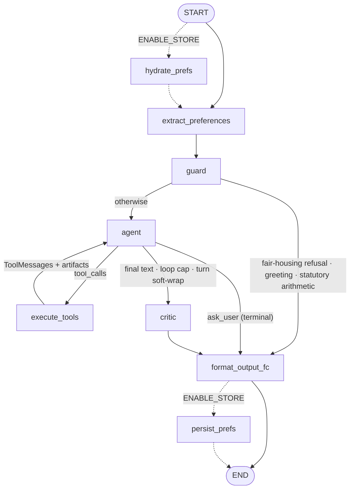

<div align="center">


# RentCompass

### Find somewhere to live in the UK by talking to it.

A conversational rental agent that searches real listings, plans commutes on the
TfL network, checks police.uk crime data, compares neighbourhoods, and shows the
evidence behind every number it gives you.

[](https://github.com/shuhan-wang1/RentCompass/actions/workflows/ci.yml)


</div>

---

## Contents

- [What it does](#what-it-does)
- [Architecture](#architecture)
- [Tools](#tools)
- [Safety, grounding and validators](#safety-grounding-and-validators)
- [Conversations, context and memory](#conversations-context-and-memory)
- [HTTP API](#http-api)
- [Getting started](#getting-started)
- [Configuration](#configuration)
- [Testing](#testing)
- [Evaluation](#evaluation)
- [Project layout](#project-layout)
- [Further documentation](#further-documentation)
- [Licence](#licence)

---

## What it does

Ask it things like:

> **"Find me a 1-bed under £1800 near Stratford, commute to UCL under 35 minutes."**
> → searches live listings, routes each one on TfL, ranks by price, commute and fit
>
> **"Which of these areas is safest, and what's the rent difference?"**
> → police.uk crime data plus rent statistics computed from cached listings, with an
> explicit *no data* marker when an area has none
>
> **"How much is a single Tube fare from Stratford to Bank in the morning peak?"**
> → the TfL fare, not a number the model remembers
>
> **"Drop anything over £2000 and sort the rest by distance to the tube."**
> → filters the listings already on screen, deterministically, without re-running the search
>
> **"我下个月要搬到伦敦，预算 1500 镑，帮我找找。"**
> → replies in the language you asked in

Features:

- **Live property search.** Scrapes OnTheMarket on demand, normalises listings into a
  rich schema and caches them in SQLite with a TTL. Criteria accumulate across turns:
  area, budget (weekly or monthly), bedrooms, room type, commute destination,
  travel-time cap, amenities and soft preferences.
- **Commute planning.** TfL Journey Planner itineraries with journey time *and* fare. A
  straight-line fallback is labelled as an estimate rather than presented as a routed
  journey.
- **Area intelligence.** Crime and safety data from data.police.uk, nearby points of
  interest from OpenStreetMap Overpass, and an explainable value-for-money ranking of
  candidate areas computed from cached listing prices.
- **Neighbourhood recommendation.** Given a university or workplace, proposes areas to
  live in (web search → LLM extraction → validation of every candidate against real
  geocoding and commute data). Candidates that fail validation are dropped.
- **Two search surfaces.** A conversational endpoint (`/api/alex`) and a deterministic
  structured form (`/api/search_direct`) that bypasses the model and writes into the
  same conversation state.
- **In-place refinement.** Narrowing requests filter and re-sort the listings already on
  screen, so the prose cannot describe a different set from the one the results panel
  shows.
- **Conversation branching.** Fork from any completed turn, edit an earlier message to
  create an alternative branch, and compare two branches side by side.
- **Long-term memory.** Per-user durable facts in SQLite, exposed to the agent as
  `recall_memory` / `remember` tools and erasable through `/api/forget_me`.
- **Bilingual.** Replies follow an explicit English/Chinese language policy driven by the
  message and the UI language.

---

## Architecture

The codebase is two cooperating trees:

- **`src/uk_rent_agent/`** — the installable package: ASGI entry point, configuration,
  state and contracts, checkpoint persistence, guardrails, the critic, LLM routing,
  web stores (auth, sessions, conversations, rate limiting) and the evaluation gate.
- **`app/`** — the domain application: Flask routes (`app/app.py`), the agent graphs,
  tools, scraping, RAG and memory. The ASGI shell loads it at runtime.

```text
Browser (app/unified-ui.html)
        │
        ▼
Starlette ASGI shell  (uk_rent_agent.web.asgi)
   ├── GET  /live, /ready, /health     served natively
   ├── POST /api/alex                  async JSON, or stage events over SSE
   └── Mount("/") ──▶ Flask app (app/app.py)
                         │
          ┌──────────────┼───────────────────────┐
          ▼              ▼                       ▼
     /api/alex    /api/search_direct     conversation / auth /
          │        (no LLM router)       favourites / map routes
          ▼
   agent graph (selected by AGENT_ARCH)
          │
          ▼
   tool provider ── in-process ToolRegistry
                 └─ or MCPToolClient ──▶ app/mcp_server.py (stdio)
          │
          ▼
   TfL · police.uk · Overpass · Nominatim · postcodes.io · OnTheMarket ·
   Open-Meteo · SearXNG (self-hosted metasearch)
```

### Agent architectures

`AGENT_ARCH` selects the conversational architecture. All of them share the tool layer,
the `extract_preferences` and `critic` nodes, the state type and the output contract;
only the orchestration differs.

| `AGENT_ARCH` | Graph builder | Shape |
|---|---|---|
| `legacy` (code default) | `app/core/langgraph_agent.py::build_agent_graph` | Classify-then-execute: deterministic and LLM tool routing, a bounded reflect loop, and a multi-intent wave executor |
| `fc_loop` | `app/core/agent_loop.py::build_fc_graph` | Native function-calling loop: one bound-tools model call per super-step |
| `manager_v1` (experimental) | `app/core/manager_v1.py::build_manager_v1_graph` | The `fc_loop` graph plus manager/task telemetry; optional read-only specialist dispatch behind `MANAGER_V1_SPECIALISTS=1` |

#### The function-calling loop (`fc_loop`)



| Node | Responsibility |
|---|---|
| `extract_preferences` | Updates hard/soft preferences, excluded areas, amenities and safety concerns from the current message. Shared with the legacy graph. |
| `guard` | Deterministic exits taken before any model call: fair-housing refusal (Equality Act 2010), a greeting fast path, and statutory rent arithmetic (deposit caps, move-in totals). |
| `agent` | Exactly one bound-tools LLM call per super-step. Emits tool calls, a final answer, or an `ask_user` clarification. |
| `execute_tools` | Runs the tool-call batch concurrently with per-tool timeouts, idempotency keys, a read/write dispatch policy and taint tracking. |
| `critic` | Checks the draft against the evidence actually gathered; unsupported money figures and ungrounded station names trigger one corrective regeneration, persistent problems get a caveat. |
| `format_output_fc` | Builds the frontend contract: recommendations, clarification payloads, safety reports, POI lists, commute-cost cards. |

Dashed nodes are opt-in: `hydrate_prefs` / `persist_prefs` appear only with a
cross-thread LangGraph Store (`ENABLE_STORE=1`), and `ENABLE_HITL=1` (with a
checkpointer) pauses the graph with `interrupt()` before a `search_properties` batch.
Because the whole loop state lives in the checkpointed `AgentState`, resuming after an
interrupt replays nothing.

**Two channels for tool output.** Every result is stored as a raw artifact
(`tool_artifacts`, used for cards and for grounding the critic) and as a derived,
length-capped `ToolMessage` for the model. Output from attacker-reachable tools
(`web_search`, `search_properties`, `get_property_details`, `search_nearby_pois`) is
sanitised on the model channel and marks the turn as tainted. Taint is computed from the
whole planned batch before anything dispatches, so a `remember` emitted beside an
untrusted read is gated even though the two run concurrently.

**Turn budget.** A turn has a wall-clock ceiling and degrades in a defined order instead
of hanging:

| Variable | Default | Meaning |
|---|---|---|
| `FC_TURN_CEILING_S` | `30.0` | Whole-turn ceiling |
| `FC_TURN_SOFT_WRAP_S` | derived (ceiling − reserves) | After this, no new tool batches; answer from what is gathered |
| `FC_FINAL_RESERVE_S` | `6.5` | Time reserved for the final generation |
| `FC_BATCH_TOOL_BUDGET_S` | `20` | Budget for one `execute_tools` batch |
| `FC_TURN_TOOL_BUDGET_S` | `40` | Cumulative tool budget per turn |
| `FC_MIN_BATCH_S` | `2.0` | Below this remaining budget no new batch starts |
| `FC_LOOP_SOFT_CAP` | `6` | Soft cap on agent ↔ tools iterations |
| `FC_TURN_CALL_CAP_<TOOL>` | `search_properties` 2, `web_search` 3, others 6 | Max executed calls of one read tool per user turn |

If the budget runs out, the answer is assembled deterministically from the artifacts
already collected rather than from a canned apology, and a dimension no tool served is
stated as missing rather than silently omitted.

**Answer guards.** A few answer shapes are corrected deterministically between the model
and the response: an answer that announces a lookup it never made forces one bounded
retry; an empty answer is regenerated and then falls back to an artifact-grounded reply;
an unverified commute claim is removed line by line and replaced by a caveat; relative
budget edits ("raise it by £200") resolve against the previous ceiling; and internal state
names are scrubbed from the final text.

#### `manager_v1` and specialists

`manager_v1` reuses the `fc_loop` graph. With `MANAGER_V1_SPECIALISTS=1` (effective only
with `AGENT_ARCH=manager_v1` and `USE_MCP_TOOLS=0`; the combination with MCP is refused at
startup), the manager-approved read batch is projected into per-role specialist tasks
(`listings`, `mobility`, `area_evidence`). A "specialist" here is a pinned, revalidated,
read-only tool grant with role-labelled telemetry — it makes **no model call of its own**
and has no separate context. `remember`, `recall_memory`, `ask_user`, state mutation and
the final answer stay manager-only. The manager receives a bounded, constant-rendered
evidence note and builds an `AnswerContract` from what shipped.

```bash
AGENT_ARCH=manager_v1 MANAGER_V1_SPECIALISTS=1 USE_MCP_TOOLS=0 uk-rent-asgi
```

#### The legacy graph

```text
START → extract_preferences → decide_tool
          ├─ single tool      → execute_tool → reflect ⟲ (bounded loop)
          ├─ multi-intent     → build_execution_plan → dispatch_tasks
          │                       → task_worker × N (Send) → gather_wave ⟲
          └─ direct answer / clarification
        → generate_response → critic → format_output → END
```

`decide_tool` routes deterministically for memory recall, result follow-ups,
property-detail questions, greetings and live transport queries, and falls back to LLM
classification otherwise.

---

## Tools

`create_tool_registry()` in `app/core/tool_system.py` is the single source of truth; the
same registry is used in-process and exposed over MCP.

| Tool | Side effect | Data source |
|---|---|---|
| `search_properties` | none | OnTheMarket on-demand scrape + SQLite listing cache, geo validation, ranking |
| `get_property_details` | none | Local listing cache, with an entity-resolution guard |
| `compare_or_rank_areas` | none | Cached listing prices (`area_stats`) + commute; explicit no-data markers |
| `calculate_commute` | none | TfL Journey Planner (transit / cycling / walking) |
| `calculate_commute_cost` | none | TfL journey + fare, combined time-and-money view |
| `get_transport_info` | none | TfL Unified API: journeys, single fares, travelcards, line status |
| `check_transport_cost` | none | TfL fare tables bundled in `uk_rent_agent.data.tfl_fares` |
| `check_safety` | none | data.police.uk, last six months |
| `search_nearby_pois` | none | OpenStreetMap Overpass (paced, multi-mirror) |
| `get_weather` | none | Open-Meteo |
| `web_search` | none | Self-hosted SearXNG |
| `recall_memory` | none | Per-user SQLite memory |
| `remember` | **write** | Per-user SQLite memory, behind the memory-write gate |
| `ask_user` | none (**terminal**) | Ends the turn with one clarifying question |

`app/mcp_server.py` serves the registry over the Model Context Protocol on stdio
(`cd app && python mcp_server.py`). With `USE_MCP_TOOLS=1` the web process calls tools
through `MCPToolClient`, falling back to the in-process registry if the subprocess is
unavailable. See [`docs/MCP.md`](docs/MCP.md).

---

## Safety, grounding and validators

| Control | Module | What it prevents |
|---|---|---|
| Taint tracking | `app/core/agent_loop.py`, `uk_rent_agent.agent.guardrails` | Instructions embedded in scraped or searched text steering the agent |
| Memory-write gate | `app/core/memory_gate.py` | A tainted, unauthorised `remember`; instruction-shaped content persisting as a memory row |
| Read dispatch policy | `app/core/tool_policy.py` | Pointless or harmful retrieval, refused before any work happens |
| DSML guard | `app/core/dsml_guard.py` | Model control tokens reaching a user surface or being persisted |
| Critic | `uk_rent_agent.agent.critic` | Unsupported money figures and invented station names |
| Commute validation | `app/core/candidate_validation.py`, `app/core/commute_basis.py` | Unevidenced commute times; straight-line estimates passed off as routed journeys |
| Fair-housing refusal / statutory arithmetic | `guard` node | Discriminatory criteria; deposit-cap and move-in questions answered by a model instead of arithmetic |
| Idempotency | `uk_rent_agent.tools.idempotency` | Duplicate durable writes on retry |
| Strict schema adapter | `app/core/strict_schema.py` | Provider-side 400s under strict function calling |
| Retired-model guard | `uk_rent_agent.llm.router` | A retired model name reaching the provider (refused at startup, successor named) |
| Web hardening | `uk_rent_agent.web.*` | Client-supplied identity, oversized bodies, unstorable text, cookie misuse, rate-limit evasion |

Grounding is also a data concern: `place_reference.py` supplies the nearest station from
TfL's StopPoint index so the field exists instead of inviting a guess; `area_stats.py`
returns `sample_size == 0` and null statistics when the cache has nothing, so the caller
emits an explicit no-data marker; and `ranking.py` drops a missing evidence component and
re-normalises the remaining weights (price 0.30, commute 0.28, semantic 0.15, features
0.10, availability 0.10, freshness 0.07) instead of scoring unknown information as a
perfect match.

---

## Conversations, context and memory

- **Durable store.** `ConversationStore` (SQLite) holds conversations, messages, turns
  and favourites. A turn is opened before generation and completed or failed after, so a
  crash leaves an explicit failed turn, never a half-written conversation.
- **Branching.** `POST /api/conversations/<id>/fork` branches from a completed turn;
  `POST …/edit_turn` rewrites an earlier user message into a new branch.
- **Context assembly.** `app/core/context_assembler.py` owns what the model sees: a token
  budget with a deterministic trim order, a rolling conversation summary, turn snapshots
  with a durable/transient whitelist (what makes forking reproducible) and
  history-conflict detection.
- **Listing references.** `focus_stack` and `recommended_registry` resolve references
  such as "the second one" or 「这套」 to real listing records.
- **Checkpoints.** LangGraph SQLite checkpoints, one file per architecture
  (`CHECKPOINT_DB_PATH`). Each file is stamped with the runtime identity that created it,
  and startup refuses to open another architecture's checkpoints.
- **Long-term memory.** `app/rag/agent_memory.py` over SQLite, namespaced per user,
  erasable via `/api/forget_me`.
- **Local accounts.** A transactional SQLite credential store with password hashes; an
  authenticated session's identity is authoritative over any client-supplied ID.

---

## HTTP API

| Method | Path | Purpose |
|---|---|---|
| `GET` | `/live` (alias `/health`) | Process liveness |
| `GET` | `/ready` | Dependency and release-identity readiness |
| `GET` | `/` | Web UI |
| `POST` | `/api/alex` | Conversational turn |
| `POST` | `/api/search_direct` | Deterministic structured search, no LLM router |
| `POST` | `/api/auth/register` · `/api/auth/login` · `/api/auth/logout` | Local auth |
| `GET` | `/api/auth/me` | Current identity |
| `GET` / `POST` | `/api/conversations` | List / create |
| `PATCH` / `DELETE` | `/api/conversations/<id>` | Rename / delete |
| `GET` | `/api/conversations/<id>/messages` | Transcript |
| `POST` | `/api/conversations/<id>/fork` | Branch from a completed turn |
| `POST` | `/api/conversations/<id>/edit_turn` | Edit a user message into a new branch |
| `GET` | `/api/conversations/<id>/version_map` · `/turns` | Branch structure |
| `POST` | `/api/clear_history` | Clear conversation history |
| `POST` | `/api/forget_me` | Erase this user's long-term memory |
| `GET` / `POST` / `DELETE` | `/api/favorites[/<url>]` | Favourites |
| `POST` | `/api/generate_map` | Folium amenity map (HTML) |

Responses carry `X-Agent-Arch` and `X-Agent-Version`; `/api/alex` echoes
`conversation_id` and `turn_id` on every outcome, including errors (agent/provider
failures are HTTP 502). Client errors are explicit: `400` for text that cannot be stored
(unpaired surrogates, NUL bytes), `413` for an over-size body, and `404` for a
`conversation_id` the caller does not own.

With `Accept: text/event-stream`, `/api/alex` streams `step` events whose `stage` is one
of `understanding`, `searching`, `checking`, `writing`, `saving`, followed by a `final`
event carrying the same verified JSON payload. No model draft or tool payload is
streamed; disconnecting cancels the turn.

---

## Getting started

### Prerequisites

- Python 3.10–3.12 (CI uses 3.12)
- A DeepSeek API key for the default cloud LLM path, or a local [Ollama](https://ollama.com)
- Docker with Compose v2, for the full stack with the SearXNG search backend

### Install

The registry dependencies are SHA-256 locked:

```bash
python3.12 -m venv .venv
.venv/bin/python -m pip install --require-hashes -r requirements-bootstrap.lock
.venv/bin/python -m pip install --require-hashes -r requirements-production.lock
.venv/bin/python -m pip install --no-deps --no-build-isolation -e .
.venv/bin/python -m pip install --require-hashes -r requirements-ci.lock   # tests only
```

After an intentional dependency change, edit the reviewed inputs/constraints and
regenerate the locks with `scripts/compile_dependency_locks.sh`; never hand-edit a
`*.lock` file. The generator environment is Python 3.12, pip 25.3, pip-tools 7.5.2 and
`click<8.5` (pip-tools 7.5.2 under click 8.5 writes a false `--no-index` into the lock
headers); the script checks this before writing a lock.

### Environment files

There are two, and they are read by different things:

| File | Read by | Holds |
|---|---|---|
| `app/.env` | the application | LLM credentials, `FLASK_SECRET_KEY`, provider and tool settings |
| `.env` (repo root) | Docker Compose, for `${VAR}` substitution | `SEARXNG_SECRET` (required by compose) and optional image pins |

```bash
cp app/.env.example app/.env
cp .env.example .env
```

Then set at least:

```env
# app/.env
FLASK_SECRET_KEY=<a long random string>
LLM_PROVIDER=deepseek
DEEPSEEK_API_KEY=<your DeepSeek API key>
DEEPSEEK_MODEL=deepseek-v4-flash
```

```env
# .env (root, compose only)
SEARXNG_SECRET=<output of: openssl rand -hex 32>
```

Retired DeepSeek model names are refused at startup with the successor named
(`RETIRED_MODEL_NAMES` in `src/uk_rent_agent/llm/router.py`).

### Run locally

```bash
.venv/bin/uk-rent-asgi              # ASGI server on http://127.0.0.1:5001
# or: python -m uk_rent_agent.web   # same server
# or: python app/app.py             # Flask development server (PORT, default 5001)

curl http://127.0.0.1:5001/live
curl http://127.0.0.1:5001/ready
```

Pick the architecture per process, e.g. `AGENT_ARCH=fc_loop .venv/bin/uk-rent-asgi`. Use a
separate `CHECKPOINT_DB_PATH` per architecture.

### Docker Compose

```bash
cp deploy/searxng-settings.yml.example searxng/settings.yml   # first time only
docker compose up -d --build
docker compose ps
```

This starts `app` (published on `127.0.0.1:5001`), `searxng` (`127.0.0.1:8080`) and
`valkey` (SearXNG's cache). All published ports bind to loopback. `app/.env` and runtime
data (vector indexes, `.runtime/`) are bind-mounted, never baked into the image. A second
app service, `app-fc`, sits behind the `canary` compose profile and does not start by
default. See [`docs/DOCKER.md`](docs/DOCKER.md).

---

## Configuration

Settings are read by `src/uk_rent_agent/config.py` (which loads `app/.env`) and by the
module that owns each subsystem. The main ones:

**Core**

| Variable | Default | Purpose |
|---|---|---|
| `FLASK_SECRET_KEY` | — | Session signing key; required by the ASGI server |
| `LLM_PROVIDER` | `deepseek` | `deepseek` or `ollama` |
| `DEEPSEEK_API_KEY` / `DEEPSEEK_BASE_URL` | — / `https://api.deepseek.com` | DeepSeek credentials and endpoint |
| `DEEPSEEK_MODEL` | `deepseek-v4-flash` | Model name; retired names are refused |
| `OLLAMA_BASE_URL` / `OLLAMA_MODEL` | `http://localhost:11434` / see `app/.env.example` | Local model settings |
| `AGENT_ARCH` | `legacy` | `legacy`, `fc_loop` or `manager_v1` |
| `MANAGER_V1_SPECIALISTS` | `0` | Read-only specialist dispatch (only with `manager_v1` and `USE_MCP_TOOLS=0`) |
| `DEEPSEEK_STRICT` | `0` | Strict function calling for the function-calling loop |
| `USE_MCP_TOOLS` | `0` | Call tools through the MCP subprocess instead of in-process |
| `ENABLE_HITL` / `ENABLE_STORE` | `0` / `0` | Human-in-the-loop interrupt; cross-thread preference Store |
| `PROPERTY_SOURCE` | `auto` | `auto`/`scraper` use real scraped snapshots; `csv` enables bundled demo rows |
| `SCRAPE_ON_STARTUP` | `0` | Allow scraping at startup |
| `SCRAPER_CACHE_TTL_HOURS` | `24` | Listing cache freshness window |
| `SEARXNG_URL` | `http://localhost:8080` | Search backend (`http://searxng:8080` under compose) |
| `TFL_APP_KEY` | empty | Optional; raises TfL rate limits |

**State paths** (defaults are under `.runtime/` in the repo)

| Variable | Default | Purpose |
|---|---|---|
| `CHECKPOINT_DB_PATH` | `.runtime/checkpoints.sqlite3` | LangGraph checkpoints, one per architecture |
| `CONVERSATION_DB_PATH` | next to the checkpoint DB | Conversation store |
| `AUTH_DB_PATH` | `.runtime/auth.sqlite3` | Local credential store |
| `RATE_LIMIT_DB_PATH` | `.runtime/rate_limits.sqlite3` | Rate-limit ledger |
| `ENABLE_CHECKPOINTER` | `1` | Enable checkpoints |
| `CANARY_LOG_PATH` | `<checkpoint dir>/logs/canary-<arch>.jsonl` | Per-turn telemetry sink; `off` disables |

**Web and security**

| Variable | Default | Purpose |
|---|---|---|
| `REQUIRE_AUTH` | `0` | Require an authenticated session on `/api/*` |
| `SESSION_COOKIE_SECURE` | `0` | Set to `1` behind TLS |
| `CORS_ORIGINS` | `http://127.0.0.1:5001,http://localhost:5001` | Comma-separated allowed origins |
| `ALLOW_LEGACY_CLIENT_USER_ID` | `0` | Accept client-supplied user IDs (migrations only) |
| `MAX_REQUEST_BYTES` | `262144` | Request-size cap (over it: 413) |
| `RATE_LIMIT_WINDOW_SECONDS` | `60` | Sliding-window limiter |
| `TRUSTED_PROXY_IPS` | empty | Peers whose `X-Forwarded-For` is believed when choosing a rate-limit subject |

The turn budget (`FC_*`, above), the search and POI budgets (`SEARCH_*`, `POI_*`,
`OVERPASS_*`), the area-recommendation cache (`AREA_RECO_*`) and the geocode caches
(`GEOCODE_*`) are all tunable without a code change; each is documented at its
definition.

---

## Testing

```bash
.venv/bin/python -m pytest -q
```

`pyproject.toml` runs two trees: `tests/` (the runtime under `app/`) and
`tests_refactor/` (the `uk_rent_agent` package under `src/`). Both are hermetic — LLM and
network calls are stubbed — and the few live integration tests are off unless
`RUN_LIVE_OSM` / `RUN_LIVE_SCRAPE` are set. Tests that check a deployment host's installed
files skip where those files do not exist.

Point the state paths at a scratch directory so a test run never writes into a real
`.runtime/` (CI does the same):

```bash
T=$(mktemp -d)
CHECKPOINT_DB_PATH=$T/checkpoints.sqlite3 CONVERSATION_DB_PATH=$T/conversations.sqlite3 \
AUTH_DB_PATH=$T/auth.sqlite3 RATE_LIMIT_DB_PATH=$T/rate-limits.sqlite3 \
RUNTIME_CACHE_PATH=$T/runtime-cache.sqlite3 SEARCH_LISTING_CACHE_PATH=$T/listing-cache.sqlite3 \
SEARCH_CACHE_DB_PATH=$T/search-cache.sqlite3 AGENT_MEMORY_DB_PATH=$T/agent-memory \
ENABLE_CHECKPOINTER=0 BACKGROUND_JOBS_ENABLED=0 CANARY_LOG_PATH=off \
.venv/bin/python -m pytest -q --basetemp "$T/pytest" --randomly-seed=1009
```

CI (`.github/workflows/ci.yml`) runs on pushes to `main` and on pull requests: the full
suite twice on Python 3.12 in two random orders, a Compose build with liveness/readiness
probes, an offline evaluation smoke, and supply-chain gates (secret scan, hash-locked
installs, dependency vulnerability audit, CycloneDX SBOM). `.pre-commit-config.yaml`
provides a staged-change gitleaks check and local hygiene hooks. More detail in
[`docs/TESTING.md`](docs/TESTING.md).

---

## Evaluation

`evaluation/` is a self-contained, offline-first evaluation framework covering routing,
tool use, grounding, cost, latency, resilience and memory.

```bash
python -m evaluation.run_benchmark --smoke --offline          # 10 smoke cases, mechanics only
python -m evaluation.run_benchmark --live --config routed_models --max-cost-usd 5
python -m evaluation.run_ablation --study both --offline --smoke
python -m evaluation.fault_injection.run                      # injected-fault scenarios
python -m evaluation.memory_eval
python -m evaluation.report --results evaluation/results --out evaluation/results
```

Methodology:

- **A 98-case benchmark** across seven categories (retrieval, money, commute, crime/POI,
  multi-constraint, grounding, memory) with machine-checkable constraints and recorded
  tool fixtures for deterministic replay. Frozen held-out sets live under
  `evaluation/benchmark/holdout_v*/`, each with its preregistration.
- **Offline by default.** A deterministic fake model makes runs free and repeatable;
  `--live` uses the real provider under a hard cost cap that refuses to start a case whose
  estimated cost would exceed it.
- **Repeat-all gating.** With `--repeat K` a hard-gate case passes only when all K repeats
  pass. A separate zero-tolerance sweep fails the run on any forbidden tool execution,
  tainted write, budget breach or unsupported number.
- **Honest denominators.** Every reported figure carries its `num/den` and source file; a
  metric that was not produced says so with the reason and is never estimated.
- **Release evidence gate.** `uk-rent-eval-gate` verifies a sealed evidence package
  (frozen identities, artifact hashes, preregistered floors) and recomputes its report
  before passing it; see `evaluation/benchmark/holdout_v7/README.md`.

Archived result files are in `evaluation/results/`; the framework guide is
[`evaluation/README.md`](evaluation/README.md).

---

## Project layout

```text
.
├── src/uk_rent_agent/        installable package (pip install -e .)
│   ├── agent/                state, contracts, critic, guardrails, persistence
│   ├── data/                 cache, parsing, repository, TfL fares
│   ├── domain/               schema and constants
│   ├── evals/                metrics and the evidence gate
│   ├── llm/                  model router and retired-name guard
│   ├── tools/                idempotency
│   └── web/                  ASGI shell, chat transport, auth/session/conversation stores,
│                             identity, rate limiting
├── app/                      domain application
│   ├── app.py                Flask routes
│   ├── mcp_server.py         MCP stdio server
│   ├── unified-ui.html       web UI
│   ├── core/                 agent graphs, prompts, policies, validators, ranking,
│   │   ├── scraping/         OnTheMarket provider, cache, normalisation
│   │   └── tools/            the tool implementations
│   ├── rag/                  embeddings, agent memory
│   └── scripts/              dataset build, OSM prefetch
├── evaluation/               offline evaluation framework and archived results
├── evals/                    small diagnostic golden sets
├── tests/ · tests_refactor/  test trees
├── deploy/                   reference deployment scripts, nginx templates, monitoring
├── scripts/                  telemetry report/cost tools, dependency-lock tooling
├── docs/                     design and operations documents
├── examples/                 runnable LangGraph HITL/Store/time-travel demo
├── fine_tuning/              optional offline extraction fine-tuning (not used at runtime)
├── Dockerfile · docker-compose.yml · pyproject.toml
└── constraints-production.txt · requirements-*.lock
```

Runtime data is gitignored: `.runtime/` (checkpoints, conversation DB, auth store,
telemetry logs), `chroma_db/`, `chroma_db_area/`, `app/chroma_db_agent_memory/`,
`app/data/`.

---

## Further documentation

| Document | Covers |
|---|---|
| [`docs/DOCKER.md`](docs/DOCKER.md) | Running the container stack |
| [`docs/MCP.md`](docs/MCP.md) | MCP server and client integration |
| [`docs/TESTING.md`](docs/TESTING.md) | The two test trees and how imports resolve |
| [`docs/harness_migration_design.md`](docs/harness_migration_design.md) | The design behind the function-calling loop |
| [`docs/eval_infrastructure.md`](docs/eval_infrastructure.md) · [`docs/evaluator_contract.md`](docs/evaluator_contract.md) | Measurement infrastructure and the evaluator contract |
| [`docs/canary_runbook.md`](docs/canary_runbook.md) | The two-service canary tooling in `deploy/` |
| [`docs/runtime_recovery.md`](docs/runtime_recovery.md) | Encrypted backup and restore of runtime state |
| [`deploy/DEPLOY_DOMAIN.md`](deploy/DEPLOY_DOMAIN.md) | Serving behind nginx with TLS |
| [`deploy/monitoring/README.md`](deploy/monitoring/README.md) | Deploy pin gate and health monitor |
| [`evaluation/README.md`](evaluation/README.md) | Evaluation framework guide |
| [`docs/agent_design.pdf`](docs/agent_design.pdf) | Long-form architecture write-up |

---

## Licence

Educational and research use.
